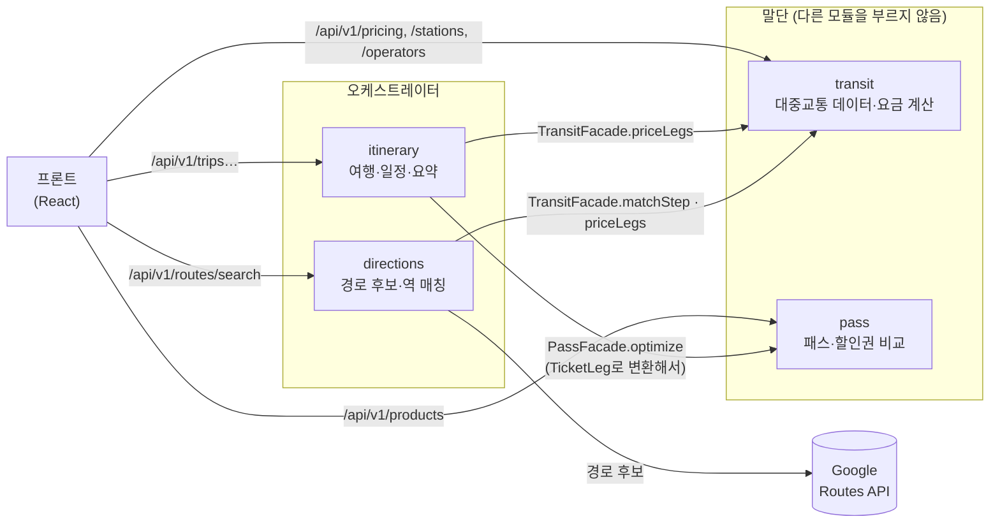
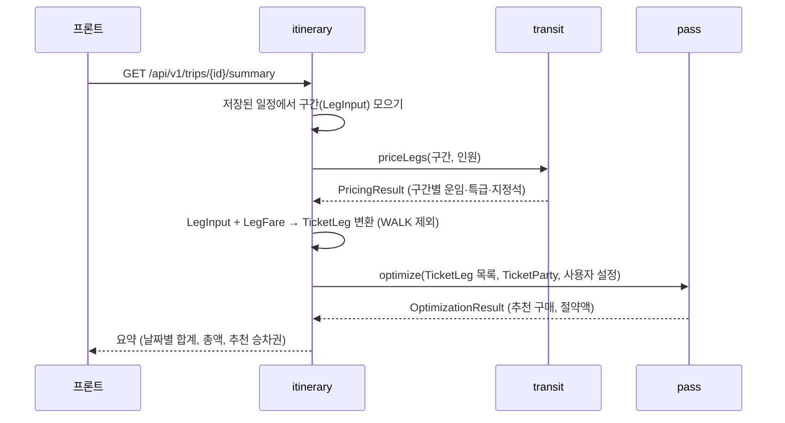
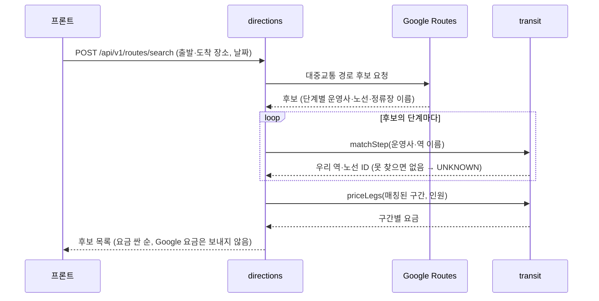

# 모듈 간 계약

다른 모듈과 프론트가 보는 것은 각 모듈의 **퍼사드**(모듈 밖의 유일한 입구. 자기 모듈의 컨트롤러도 퍼사드만 부른다)(`{module}/XxxFacade`)와 **`contract` 패키지**(주고받는 데이터 모양)뿐이다. 이 문서가 그 약속의 원본이다.

- 0단계에서는 코드로 만들지 않는다. **각 모듈 세션이 자기 `contract` 타입과 퍼사드를 이 문서대로 만든다.**
- 프론트 `frontend/src/api/types.ts`는 프론트 세션이 이 문서를 보고 TypeScript로 옮긴다(필드 이름 동일).
- 이 문서와 다르게 바꿔야 하면 이 문서를 먼저 고치고 커밋 메시지 끝에 `[contract]`를 붙인다.
- 모든 타입은 Java record 또는 enum. 금액은 지역 통화의 정수 최소 단위.
- **어린이 요금은 다루지 않는다**(v1 비목표). 인원은 어른 수(`adults`)만, 금액은 어른 1명 기준. 나중에 어린이를 넣을 때는 필드를 추가한다.
- `contract`의 enum은 모두 **코드 enum**이다(아래 "코드 enum"). 응답에서는 `{code, label, description}` 객체로 나간다.

## 코드 enum (라벨·설명)

`contract` 패키지의 enum은 화면에 보일 한글 이름(`label`)과 설명(`description`)을 가진다. 공통 인터페이스 없이 **enum마다 아래 모양을 그대로 쓴다**(사용자 결정: 공통 코드를 두지 않음).

```java
// 예: transit/contract/TrainClass.java
@Getter
@RequiredArgsConstructor
@JsonFormat(shape = JsonFormat.Shape.OBJECT)
public enum TrainClass {
    LOCAL("보통", "운임만 내는 열차"),
    EXPRESS("특급", "운임에 특급요금이 더해지는 열차");

    private final String label;
    private final String description;

    @JsonProperty("code")
    public String getCode() {
        return name();
    }

    /** 요청 값: 코드 문자열 "EXPRESS" 또는 응답으로 받은 객체 {"code": "EXPRESS", ...}. 모르는 코드면 예외 → 400 INVALID_INPUT. */
    @JsonCreator
    public static TrainClass from(Object value) {
        String code = value instanceof Map<?, ?> map ? (String) map.get("code") : (String) value;
        return valueOf(code);
    }
}
```

- **응답(JSON):** `"trainClass": {"code": "EXPRESS", "label": "특급", "description": "운임에 특급요금이 더해지는 열차"}`
- **요청(JSON):** 코드 문자열 `"EXPRESS"`와 객체 `{"code": "EXPRESS", ...}` 둘 다 받는다(각 enum의 `from`). 응답으로 받은 값을 그대로 다시 보내도 된다. 모르는 코드는 400 `INVALID_INPUT`.
- **프론트:** `interface CodeValue<C extends string> { code: C; label: string; description: string }`. 화면에는 `label`을 보여주고, 설명은 툴팁 등에 쓴다. 비교는 `code`로.
- **DB:** 엔티티에는 `@Enumerated(EnumType.STRING)`으로 코드만 저장한다.
- 라벨·설명을 고치는 것은 계약 변경이 아니다(코드값을 바꾸거나 지울 때만 `[contract]`).

| enum | 모듈 | 코드 → 라벨 / 설명 |
|---|---|---|
| `FareStatus` | transit | `OK` 확인됨 / 자체 요금 데이터로 계산한 요금 · `UNKNOWN` 미확인 / 요금 데이터에 없어 계산하지 못한 구간 · `MANUAL` 직접 입력 / 사용자가 입력한 요금 |
| `LegMode` | transit | `TRANSIT` 대중교통 / 열차·버스처럼 요금이 드는 구간 · `WALK` 도보 / 요금이 없는 걷는 구간 · `MANUAL` 직접 입력 / 요금을 직접 입력한 구간 |
| `TrainClass` | transit | `LOCAL` 보통 / 운임만 내는 열차 · `EXPRESS` 특급 / 운임에 특급요금이 더해지는 열차 |
| `SeatType` | transit | `UNRESERVED` 자유석 / 좌석을 지정하지 않는 자리 · `RESERVED` 지정석 / 지정석 요금을 내고 예약하는 자리 |
| `ProductType` | pass | `PASS` 패스 / 정해진 기간 동안 대상 노선을 자유롭게 타는 승차권 · `FIXED_ROUTE` 구간 승차권 / 정해진 구간을 정해진 횟수만큼 타는 왕복권·회수권 |

## 의존 관계

itinerary와 directions가 다른 모듈을 부르는 **오케스트레이터**, transit과 pass는 아무도 부르지 않는 **말단**이다. pass는 transit을 모른다(`ArchitectureTest.passDoesNotDependOnTransit`).



### 여행 요약을 만들 때



### 경로 후보를 찾을 때



## transit (`com.transitfare.transit`)

```java
// contract
// 코드 enum — 라벨·설명은 위 "코드 enum" 표
public enum FareStatus { OK, UNKNOWN, MANUAL }
public enum LegMode { TRANSIT, WALK, MANUAL }
public enum TrainClass { LOCAL, EXPRESS }
public enum SeatType { UNRESERVED, RESERVED }

public record Passengers(int adults) {}

public record LegInput(LegMode mode, String operatorCode, Long lineId,
                       Long fromStationId, Long toStationId,
                       TrainClass trainClass, SeatType seatType,
                       Integer manualAmount,
                       boolean continuesPreviousTrain) {}  // 앞 구간과 같은 열차를 계속 타고 감(노선만 바뀜). 기본 false

/**
 * 금액은 어른 1명 기준(base 운임, express 특급요금, reserved 지정석 요금). partyTotal = (base + express + reserved) × adults.
 * 연속 거리제 묶음은 첫 구간에 금액, 이어지는 구간은 0 + note "앞 구간과 합산". 같은 묶음은 같은 groupId(묶음 아니면 null).
 */
public record LegFare(int legIndex, FareStatus status,
                      int base, int express, int reserved,
                      int partyTotal, String operatorCode, String note, Integer groupId) {}

public record PricingResult(List<LegFare> legs, int partyTotal, boolean hasUnknown) {}
public record RegionView(String code, String nameKo, String currency, String timezone) {}
public record LineRef(long lineId, String nameKo) {}
public record StationView(long id, String operatorCode, String nameJa, String nameKo, List<LineRef> lines) {}
public record OperatorView(String code, String nameJa, String nameKo, String fareBasisNote) {}
public record StepToMatch(String agencyName, String lineName, String trainName,
                          String departureStopName, String arrivalStopName) {}
public record MatchedLeg(String operatorCode, Long lineId, long fromStationId, long toStationId,
                         TrainClass trainClass) {}

// TransitFacade
public interface TransitFacade {
    PricingResult priceLegs(String regionCode, List<LegInput> legs, Passengers passengers);
    List<StationView> searchStations(String regionCode, String operatorCode, String query);
    List<OperatorView> listOperators(String regionCode);
    RegionView getRegion(String regionCode);
    Optional<MatchedLeg> matchStep(String regionCode, StepToMatch step);
}
```

## pass (`com.transitfare.pass`) — transit을 모른다

```java
// contract
public record TicketParty(int adults) {}

/**
 * 승차권 비교용 구간. itinerary가 transit의 LegInput + LegFare를 이 모양으로 바꿔서 넘긴다.
 * fareKnown=false(요금 미확인·직접 입력)인 구간은 승차권으로 커버하지 않는다.
 * groupId: 연속 거리제 묶음(LegFare.groupId 그대로). 묶음 전 구간이 커버될 때만 절감.
 */
public record TicketLeg(LocalDate date, String operatorCode, Long lineId,
                        Long fromStationId, Long toStationId,
                        boolean express, boolean reserved, boolean fareKnown,
                        int base, int expressFare, int reservedFare,
                        Integer groupId) {}

// 코드 enum — 라벨·설명은 위 "코드 enum" 표
public enum ProductType { PASS, FIXED_ROUTE }

public record ProductView(String code, ProductType type, String nameKo, String nameJa,
                          int price, int validDays, String eligibilityNote) {}
/** priceAmount가 null이면 공식가 */
public record ProductOverride(String productCode, boolean included, Integer priceAmount) {}
public record Purchase(String productCode, LocalDate startDate, int unitPrice, int count) {}
/** legCoveredBy: TicketLeg 순번 → productCode */
public record OptimizationResult(int baselineTotal, int optimizedTotal, List<Purchase> purchases,
                                 Map<Integer, String> legCoveredBy) {}

// PassFacade
public interface PassFacade {
    List<ProductView> listProducts(String regionCode);
    OptimizationResult optimize(String regionCode, List<TicketLeg> legs, TicketParty party,
                                List<ProductOverride> overrides);
}
```

## directions (`com.transitfare.directions`) — transit의 contract 타입 사용

```java
// contract
public record PlaceRef(String placeId, String name) {}
public record CandidateLegView(LegInput input, LegFare fare,
                               String googleLineName, String googleFromName, String googleToName) {}
public record CandidateView(int candidateIndex, List<CandidateLegView> legs, int partyTotal,
                            boolean hasUnknown, String summary, String encodedPolyline) {}

// DirectionsFacade
public interface DirectionsFacade {
    List<CandidateView> search(String regionCode, PlaceRef origin, PlaceRef destination,
                               LocalDate date, Passengers passengers);
}
```

## itinerary (`com.transitfare.itinerary`)

다른 모듈은 itinerary를 쓰지 않는다. 그래도 **컨트롤러는 퍼사드만 부른다**는 규칙에 따라 `ItineraryFacade`를 두고, 자기 컨트롤러(`TripController`)만 쓴다. 메서드는 Task 6, 8의 API와 1:1(여행·일정 CRUD, 승차권 설정, 요약)이며 itinerary 세션이 정한다. `contract` 패키지에는 itinerary REST API가 주고받는 모양(`TripDto`, `SegmentDto`, `SummaryDto`, `ProductSettingDto`)을 둔다 — 구현 계획 Task 6, 8 참고.

### itinerary가 하는 변환 (LegInput + LegFare → TicketLeg)

| TicketLeg | 값 |
|---|---|
| `date` | 구간의 `travel_date` |
| `operatorCode`, `lineId`, `fromStationId`, `toStationId` | `LegInput` 그대로 |
| `express` | `trainClass == EXPRESS` |
| `reserved` | `seatType == RESERVED && !continuesPreviousTrain` (지정석은 열차 하나에 1회 — 이어 타는 구간은 세지 않음) |
| `fareKnown` | `status == OK` (`UNKNOWN`, `MANUAL`이면 false) |
| `base`, `expressFare`, `reservedFare` | `LegFare`의 `base`, `express`, `reserved` 그대로 |
| `groupId` | `LegFare.groupId` |
| (제외) | `WALK` 구간은 넘기지 않는다 |
