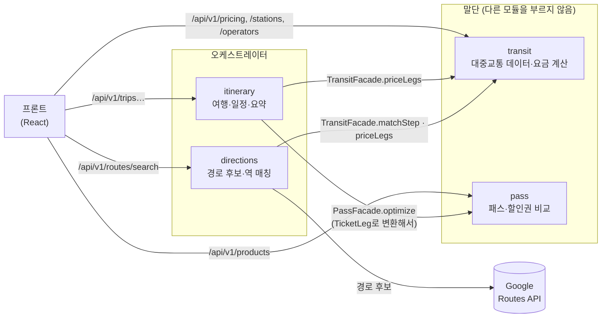
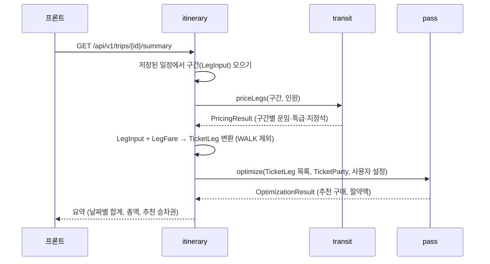
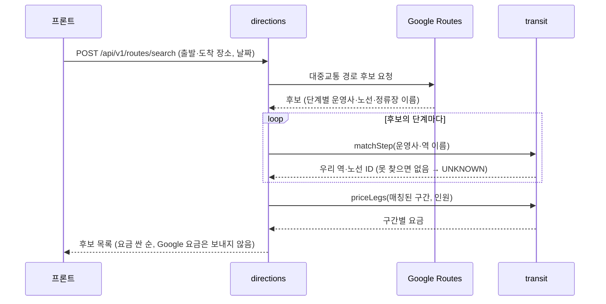

# 모듈 간 계약

다른 모듈과 프론트가 보는 것은 각 모듈의 **퍼사드**(`{module}/XxxFacade`)와 **`contract` 패키지**(주고받는 데이터 모양)뿐이다. 이 문서가 그 약속의 원본이다.

- 0단계에서는 코드로 만들지 않는다. **각 모듈 세션이 자기 `contract` 타입과 퍼사드를 이 문서대로 만든다.**
- 프론트 `frontend/src/api/types.ts`는 프론트 세션이 이 문서를 보고 TypeScript로 옮긴다(필드 이름 동일).
- 이 문서와 다르게 바꿔야 하면 이 문서를 먼저 고치고 커밋 메시지 끝에 `[contract]`를 붙인다.
- 모든 타입은 Java record 또는 enum. 금액은 지역 통화의 정수 최소 단위.

## 의존 관계

itinerary와 directions가 다른 모듈을 부르는 **오케스트레이터**, transit과 pass는 아무도 부르지 않는 **말단**이다. pass는 transit을 모른다(`ArchitectureTest.passDoesNotDependOnTransit`).



### 여행 요약을 만들 때



### 경로 후보를 찾을 때



## transit (`com.transitfare.transit`)

```java
// contract
public enum FareStatus { OK, UNKNOWN, MANUAL }
public enum LegMode { TRANSIT, WALK, MANUAL }
public enum TrainClass { LOCAL, EXPRESS }
public enum SeatType { UNRESERVED, RESERVED }

public record Passengers(int adults, int children) {}

public record LegInput(LegMode mode, String operatorCode, Long lineId,
                       Long fromStationId, Long toStationId,
                       TrainClass trainClass, SeatType seatType,
                       Integer manualAdultAmount, Integer manualChildAmount) {}

/** 연속 거리제 묶음은 첫 구간에 금액, 이어지는 구간은 0 + note "앞 구간과 합산". 같은 묶음은 같은 groupId(묶음 아니면 null). */
public record LegFare(int legIndex, FareStatus status,
                      int baseAdult, int expressAdult, int reservedAdult,
                      int baseChild, int expressChild, int reservedChild,
                      int partyTotal, String operatorCode, String note, Integer groupId) {}

public record PricingResult(List<LegFare> legs, int partyTotal, boolean hasUnknown) {}
public record RegionView(String code, String nameKo, String currency, String timezone) {}
public record LineRef(long lineId, String nameKo) {}
public record StationView(long id, String operatorCode, String nameJa, String nameKo, List<LineRef> lines) {}
public record OperatorView(String code, String nameJa, String nameKo, String fareBasisNote) {}
public record StepToMatch(String agencyName, String lineName, String trainName,
                          String departureStopName, String arrivalStopName) {}
public record MatchedLeg(String operatorCode, Long lineId, long fromStationId, long toStationId,
                         TrainClass trainClass) {}

// TransitFacade
public interface TransitFacade {
    PricingResult priceLegs(String regionCode, List<LegInput> legs, Passengers passengers);
    List<StationView> searchStations(String regionCode, String operatorCode, String query);
    List<OperatorView> listOperators(String regionCode);
    RegionView getRegion(String regionCode);
    Optional<MatchedLeg> matchStep(String regionCode, StepToMatch step);
}
```

## pass (`com.transitfare.pass`) — transit을 모른다

```java
// contract
public record TicketParty(int adults, int children) {}

/**
 * 승차권 비교용 구간. itinerary가 transit의 LegInput + LegFare를 이 모양으로 바꿔서 넘긴다.
 * fareKnown=false(요금 미확인·직접 입력)인 구간은 승차권으로 커버하지 않는다.
 * groupId: 연속 거리제 묶음(LegFare.groupId 그대로). 묶음 전 구간이 커버될 때만 절감.
 */
public record TicketLeg(LocalDate date, String operatorCode, Long lineId,
                        Long fromStationId, Long toStationId,
                        boolean express, boolean reserved, boolean fareKnown,
                        int baseAdult, int expressAdult, int reservedAdult,
                        int baseChild, int expressChild, int reservedChild,
                        Integer groupId) {}

public record ProductView(String code, String type, String nameKo, String nameJa,
                          int adultPrice, Integer childPrice, int validDays, String eligibilityNote) {}
/** adultPriceAmount가 null이면 공식가 */
public record ProductOverride(String productCode, boolean included, Integer adultPriceAmount) {}
/** passengerType: ADULT | CHILD */
public record Purchase(String productCode, LocalDate startDate, String passengerType, int unitPrice, int count) {}
/** legCoveredBy: TicketLeg 순번 → productCode */
public record OptimizationResult(int baselineTotal, int optimizedTotal, List<Purchase> purchases,
                                 Map<Integer, String> legCoveredBy) {}

// PassFacade
public interface PassFacade {
    List<ProductView> listProducts(String regionCode);
    OptimizationResult optimize(String regionCode, List<TicketLeg> legs, TicketParty party,
                                List<ProductOverride> overrides);
}
```

## directions (`com.transitfare.directions`) — transit의 contract 타입 사용

```java
// contract
public record PlaceRef(String placeId, String name) {}
public record CandidateLegView(LegInput input, LegFare fare,
                               String googleLineName, String googleFromName, String googleToName) {}
public record CandidateView(int candidateIndex, List<CandidateLegView> legs, int partyTotal,
                            boolean hasUnknown, String summary, String encodedPolyline) {}

// DirectionsFacade
public interface DirectionsFacade {
    List<CandidateView> search(String regionCode, PlaceRef origin, PlaceRef destination,
                               LocalDate date, Passengers passengers);
}
```

## itinerary (`com.transitfare.itinerary`)

다른 모듈이 itinerary를 쓰지 않으므로 퍼사드는 만들지 않는다. `contract` 패키지에는 itinerary REST API가 주고받는 모양(`TripDto`, `SegmentDto`, `SummaryDto`, `ProductSettingDto`)을 둔다 — 구현 계획 Task 6, 8 참고.

### itinerary가 하는 변환 (LegInput + LegFare → TicketLeg)

| TicketLeg | 값 |
|---|---|
| `date` | 구간의 `travel_date` |
| `operatorCode`, `lineId`, `fromStationId`, `toStationId` | `LegInput` 그대로 |
| `express` | `trainClass == EXPRESS` |
| `reserved` | `seatType == RESERVED` |
| `fareKnown` | `status == OK` (`UNKNOWN`, `MANUAL`이면 false) |
| 금액 6개 | `LegFare`의 `baseAdult` … `reservedChild` 그대로 |
| `groupId` | `LegFare.groupId` |
| (제외) | `WALK` 구간은 넘기지 않는다 |
